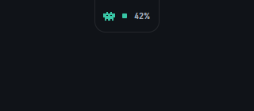
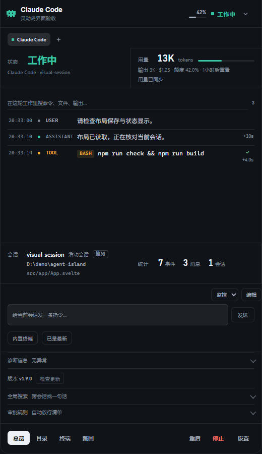
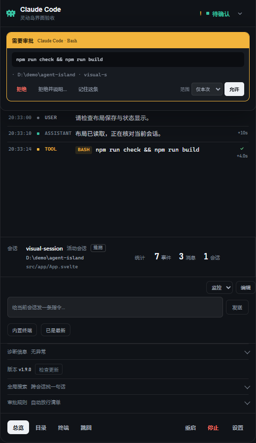
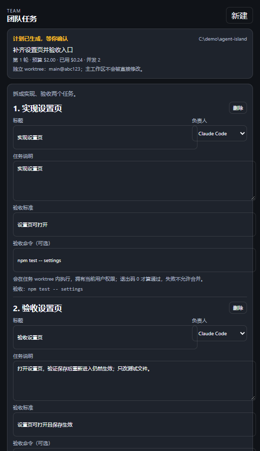
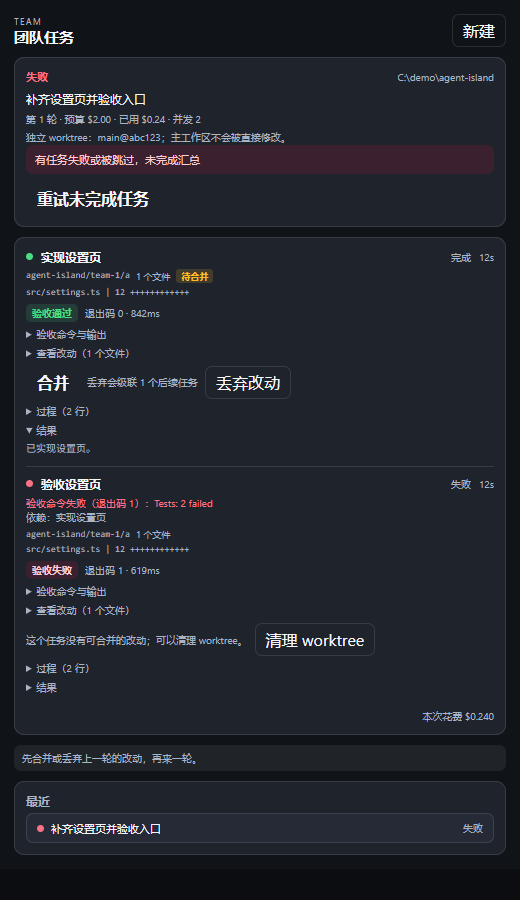

<div align="center">

# Agent Island

### 常驻 Windows 桌面的 AI 编程 Agent 灵动岛

**不用来回切终端：一眼看到谁在干活、谁在等审批，直接在小岛上处理。**

[](https://github.com/Arcticus17/agent-island/releases)
[](https://github.com/Arcticus17/agent-island/releases)
[](https://tauri.app/)
[](https://github.com/Arcticus17/agent-island/releases/latest)

**v1.10.0 测试版** · Windows 10/11 x64 · 安装包由 GitHub Actions 构建并签名更新

</div>

## 为什么选择 Agent Island？

同时跑 Claude Code、Codex CLI、OpenCode、Hermes 时，真实状态散落在不同终端里：哪个还在执行、哪个完成了、哪个在等危险命令确认，经常要一个一个窗口翻。

**Agent Island** 把这件事收进屏幕顶部的一条“灵动岛”：

- **一眼看到全部 Agent** — 胶囊态显示当前 Agent、状态和待处理数量；点击展开状态板
- **不离开桌面就能操作** — 发指令、打开目录/终端、停止、重启、跳回对应终端
- **危险命令不埋没** — Claude Code 的审批请求直接弹到岛上，允许、拒绝或回退原生确认
- **状态不靠猜** — 进行中/完成/报错/等待由结构化事件和会话绑定决定，正文文本不会改变状态
- **团队任务可验收** — 主 Agent 拆解任务，次级 Agent 在独立 git worktree 里执行；支持并发、依赖链、验收命令和手动合并
- **本地优先** — Agent 状态、日志、统计和团队记录只存在本机，不上传密钥

## 界面预览

<table>
<tr>
<td align="center" width="50%"><br>胶囊态：当前 Agent 与待处理数量</td>
<td align="center" width="50%"><br>展开态：状态板与会话</td>
</tr>
<tr>
<td align="center"><br>岛内审批：危险命令不埋没</td>
<td align="center"><br>团队任务：计划、依赖与验收命令</td>
</tr>
<tr>
<td align="center" colspan="2"><br>每个任务有真实验收结果，失败不能合并</td>
</tr>
</table>

## 下载安装

### 系统要求

- **Windows 10 / 11 x64**
- 需要 WebView2 Runtime（Windows 11 通常已内置；Windows 10 可能需要单独安装）
- 当前只验收 Windows；macOS / Linux / ARM64 不在支持范围

### Windows 用户

从 [Releases](https://github.com/Arcticus17/agent-island/releases) 下载最新版本：

| 资产 | 说明 |
| --- | --- |
| `Agent.Island_<version>_x64-setup.exe` | NSIS 安装器，普通用户推荐 |
| `Agent.Island_<version>_en-US.msi` | MSI 安装包，适合企业分发 |

`<version>` 是版本号，例如 `Agent.Island_1.10.0_x64-setup.exe`。

> **EXE 和 MSI 二选一，不要交叉覆盖。** 两种安装器的身份和升级机制不同，手动用另一种格式覆盖时可能要求先卸载旧版；应用内自动更新不受影响。
>
> 当前安装包没有 Authenticode 签名，Windows 可能提示“未知发布者”。应用内更新使用独立的 Tauri/minisign 签名，不等同于代码签名。

### 自动更新

1.9.2 及更新版本可以在应用内检查更新；1.9.1 及更早版本使用旧更新密钥，需要手动重装一次 1.9.2 或更新版本。1.9.2 → 1.9.4 的自动更新已经在 Windows 11 虚拟机中验证；1.9.4 → 1.10.0 是下一次发布验证项。

## 快速开始

1. **安装并启动** — 安装后运行 `Agent Island`，小岛默认停在屏幕顶部居中
2. **展开** — 移动鼠标到胶囊或点击它，展开状态板；点顶部按钮可收起
3. **接入 Claude 事件（可选）** — 打开「设置 → Claude 事件」检查/开启 hooks；开启后才有秒级状态、通知和岛内审批
4. **处理审批** — 危险 Bash 命令会进入岛内审批卡；允许、拒绝或回退原生确认
5. **打开总览** — 点「总览」或按 `Ctrl+Alt+O`，查看全部会话、日志和统计
6. **团队任务（实验）** — 总览顶部点「团队」，填目标、git 工作区、预算和并发，生成计划后确认执行

## 功能特性

### Agent 支持

| Agent | 状态监控 | 岛内审批 | 会话查看 | 内置终端 | 团队 worker |
| --- | :---: | :---: | :---: | :---: | :---: |
| Claude Code | ✓ | ✓ | ✓ | ✓ | ✓ |
| Codex CLI | ✓ | – | ✓ | ✓ | ✓ |
| OpenCode | ✓ | – | ✓ | ✓ | – |
| Hermes | ✓ | – | ✓ | ✓ | – |

- **审批**只接入 Claude Code hooks；其他 Agent 仍可在终端里原生确认。
- **团队 worker**支持 Claude Code 和 Codex CLI；主 Agent 可选 Claude Code / Codex CLI。
- Codex worker 在 `workspace-write` 沙箱里运行，没有岛内审批；只返回 token 用量，不返回 USD 成本，团队预算只累计 Claude 成本。
- Codex 主 Agent 用 `codex exec --output-schema` 规划；Codex 对 schema 要求更严格，计划的每个字段（含 `verify_command`）都必须出现在 `required` 里。
- Codex worker 和 Codex 主 Agent 均已包含在 v1.10.0。
- Codex 桌面端实时任务暂不在接入范围；只能手动查看本地记录，不会用历史日志冒充当前任务。

### 状态与通知

- 胶囊、状态板、通知卡三层信息：当前 Agent、做了什么、是否需要你处理
- 状态由结构化事件（Claude hooks、官方会话事件）和会话绑定决定；正文文本不会把“等待”误判成“完成”
- 报错、完成、等待通知按 Agent 分组折叠，不打断当前工作
- 历史记录与当前会话明确区分；所选记录消失时提示重新选择，不偷偷换成其他对话

### 会话、终端与统计

- **会话总览**：独立窗口实时列出会话、日志、统计，可发消息、恢复、停止、重启
- **终端跳回**：一键跳回 Agent 所在终端；Windows 拒绝切换焦点时不会报告成功
- **内置终端**：直接在小岛里跑 Agent CLI，收起岛不会杀掉会话
- **用量监控**：Claude Code 5 小时窗口 tokens/费用，Codex 额度百分比与重置倒计时
- **统计报表**：按天/周查看各 Agent 用时、报错数、完成数
- **诊断卡**：适配器解析问题和用量数据源健康同屏可见，支持脱敏导出

### 团队任务（实验）

主 Agent 拆目标，次级 Agent 执行；每个任务在独立 git worktree / 分支里完成：

- **并行**：互不依赖的任务默认并发 2，可调 1–4
- **依赖链**：任务可声明单个依赖，从依赖分支 tip 创建 worktree；同链串行，合并必须先合并依赖
- **验收命令**：worker 结束后在任务 worktree 内执行，退出码 0 才允许合并；失败保留改动但不能合并
- **预算**：按 USD 设置本轮上限，规划 / Claude worker / 汇总实际成本累计；并发时按槽位预留；Codex 不返回 USD，只计 token
- **手动合并**：团队页查看 diff，逐个选择合并或丢弃；冲突只影响该任务，不阻塞其他任务
- **再来一轮**：上一轮改动全部处理完后，主 Agent 会带着上一轮汇总和任务结果继续规划

详细规则、边界和验收记录见：

- [团队任务验证记录](docs/verification/2026-10-30-team-orchestration-spike.md)
- [第一步设计](docs/research/2026-10-30-team-orchestration-first-step.md)

> 团队任务要求工作区是至少有一次提交的 git 仓库；非 git 工作区会直接拒绝。验收命令拥有当前用户权限，不是沙箱；高风险命令会在确认计划时二次确认。

### 界面与个性化

- 深色 / 浅色 / 纯黑 / 石墨主题
- 极简、监控、调试三套布局预设；卡片可拖拽排序、切换尺寸、隐藏与恢复
- 窗口展开态最小宽度 360px，收起时回到胶囊宽度；100%–200% 缩放已验证无横向溢出
- 隐私遮罩、专注模式（全部状态 / 聚焦错误 / 静音通知）
- 尊重系统“减少动画”偏好；总览保留系统浅色模式

### 本地与隐私

- Agent 状态、日志、统计保存在本机，不上传任何密钥
- 团队任务目标、计划、任务输出保存在 `~/.agent-island/team-runs.json`，只在本机
- 诊断导出只包含脱敏元数据：应用/系统版本、适配器、会话哈希、事件类型、问题代码与计数、时间、项目目录名和消息长度；不含提示词、凭据或完整路径

## 快捷键

| 按键 | 功能 |
| --- | --- |
| `Ctrl+Alt+I` | 全局呼出 / 隐藏小岛 |
| `Ctrl+Alt+O` | 全局打开总览 |
| `Enter` / `空格` | 聚焦并操作按钮；在顶部按钮上展开 / 收起 |
| `方向键`、`Home` / `End` | 总览会话列表中切换会话 |

## 常见问题

<details>
<summary>Agent Island 会替代终端里的 Agent 吗？</summary>

不会。它负责观察状态、集中处理审批和会话入口；真正的 Agent CLI 仍在终端里运行，除非你使用岛内内置终端。
</details>

<details>
<summary>为什么有时候看不到某个 Agent？</summary>

默认只显示运行中、已固定或最近用过的 Agent。打开「+」检测列表可以查看 PATH / 常见安装目录里已安装的 Agent；未安装的不会假装可用。
</details>

<details>
<summary>为什么状态和日志里的文字不一致？</summary>

状态只信结构化事件和会话绑定，正文文本不会改变状态，最多作为诊断提示。历史日志不会被用来冒充当前任务。
</details>

<details>
<summary>团队任务为什么要求 git 仓库？</summary>

每个任务需要在独立 worktree/分支里执行，主工作区不能被直接修改。非 git 工作区无法创建隔离分支，所以会直接拒绝。主工作区有未提交改动时会提示，合并前必须先提交或暂存。
</details>

<details>
<summary>验收命令安全吗？</summary>

验收命令来自你确认的计划，拥有当前用户权限，不是沙箱。删除、推送、下载后执行等高风险命令会在确认计划时再次确认；失败的任务不会允许合并。
</details>

<details>
<summary>为什么手动安装时会提示先卸载旧版？</summary>

这是 Tauri NSIS/MSI 安装器的“已安装”维护页：两种安装器身份不同，手动交叉覆盖时可能要求先卸载。应用内自动更新走更新模式，不会弹这个页面。
</details>

<details>
<summary>为什么 Windows 提示“未知发布者”？</summary>

安装包目前没有 Authenticode 代码签名。应用内更新使用单独的 Tauri/minisign 签名，两者不是一回事。
</details>

<details>
<summary>数据存在哪里？</summary>

- `~/.agent-island/agents.json`：Agent 适配器配置
- `~/.agent-island/stats.json` / `stats-daily.json`：累计与每日统计
- `~/.agent-island/team-runs.json`：团队任务记录
- `~/.agent-island/team-runs/<run>/worktrees/`：团队任务 worktree

Claude hooks 会写入 `~/.claude/settings.json`，原文件自动备份为 `settings.json.agent-island.bak`。
</details>

## 已知限制

- **平台**：目前只验收 Windows 10/11 x64；macOS、Linux、ARM64 不列为已支持
- **Codex 桌面端**：实时任务状态和控制尚未接入；只能手动查看本地记录
- **团队任务**：当前支持 Claude Code 和 Codex CLI worker、单依赖线性链、手动合并；没有自动合并和通用 DAG
- **主 Agent**：Claude Code 和 Codex CLI 都已接入；Codex 主 Agent 已验证规划、汇总和手动合并
- **Codex worker**：无岛内审批，依赖 `workspace-write` 沙箱；不返回 USD 成本；只做主 Agent 派发的任务
- **安装包**：没有 Authenticode 签名；干净系统、普通用户、中文/空格路径、卸载残留、多显示器仍需继续验收

## 开发

技术栈：Tauri 2 / Rust + Svelte 5 / TypeScript + Vite。前端通过 `src/bridge` 与后端通信，状态、布局和主题令牌独立维护。

```bash
npm ci
npx playwright install chromium
npm run tauri dev
```

回归与构建：

```bash
npm run check
npm test
cargo test --manifest-path src-tauri/Cargo.toml --lib
npm run tauri build
```

- `npm test` 包含旧前端、单元、浏览器交互、视觉比对和 Rust 测试
- 视觉基线覆盖主岛 16 个状态 + 团队页/团队条 5 个状态；只有人工确认后才执行 `npm run test:visual:update`
- 发布：`npm run release:patch` 改版本号，提交后打 `vX.Y.Z` tag；GitHub Actions 会构建并发布 EXE/MSI、`.sig` 与 `latest.json`
- 详细验证记录：[docs/verification/](docs/verification/)，索引在 [验证记录索引](docs/verification/README.md)

## 贡献

欢迎提交 Issue 和 PR。涉及状态判定、窗口行为或团队调度的改动，请同时补测试和验证记录；不要提交密钥、凭据或本机路径。

## Star History

[](https://star-history.com/#Arcticus17/agent-island&Date)

## License

本项目采用 [Apache License 2.0](LICENSE)。

```text
Copyright 2026 Arcticus17

Licensed under the Apache License, Version 2.0 (the "License");
you may not use this file except in compliance with the License.
You may obtain a copy of the License at

    http://www.apache.org/licenses/LICENSE-2.0

Unless required by applicable law or agreed to in writing, software
distributed under the License is distributed on an "AS IS" BASIS,
WITHOUT WARRANTIES OR CONDITIONS OF ANY KIND, either express or implied.
See the License for the specific language governing permissions and
limitations under the License.
```
