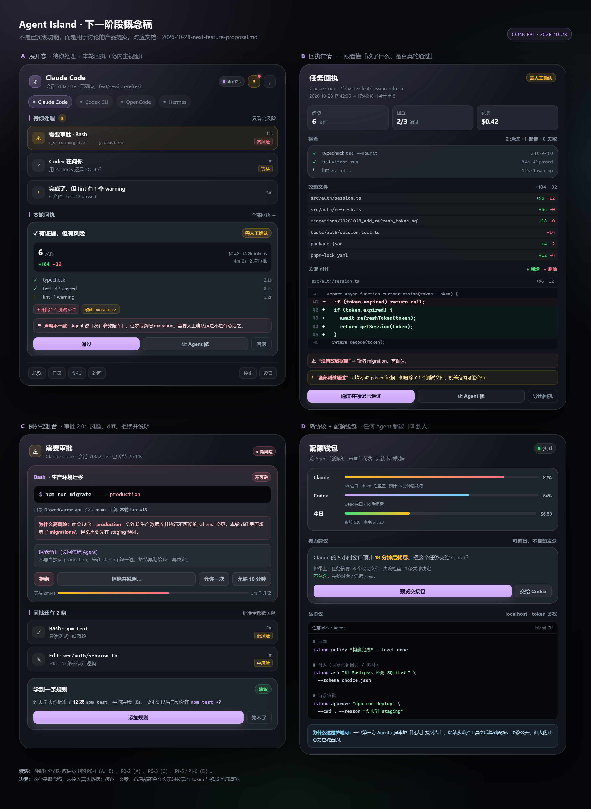
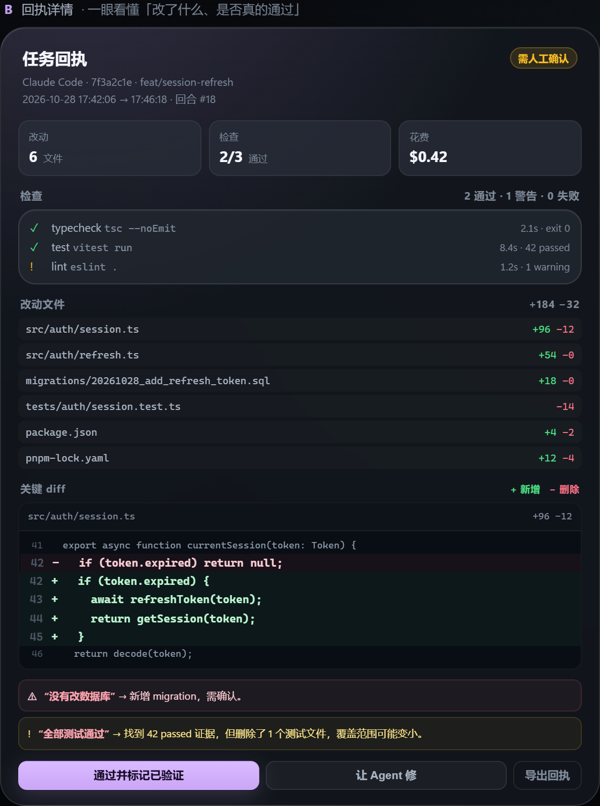
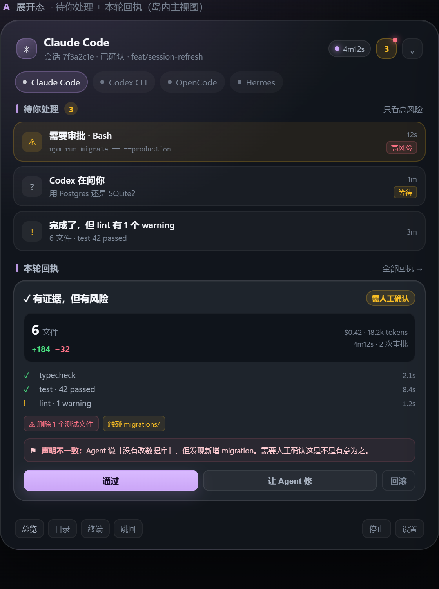
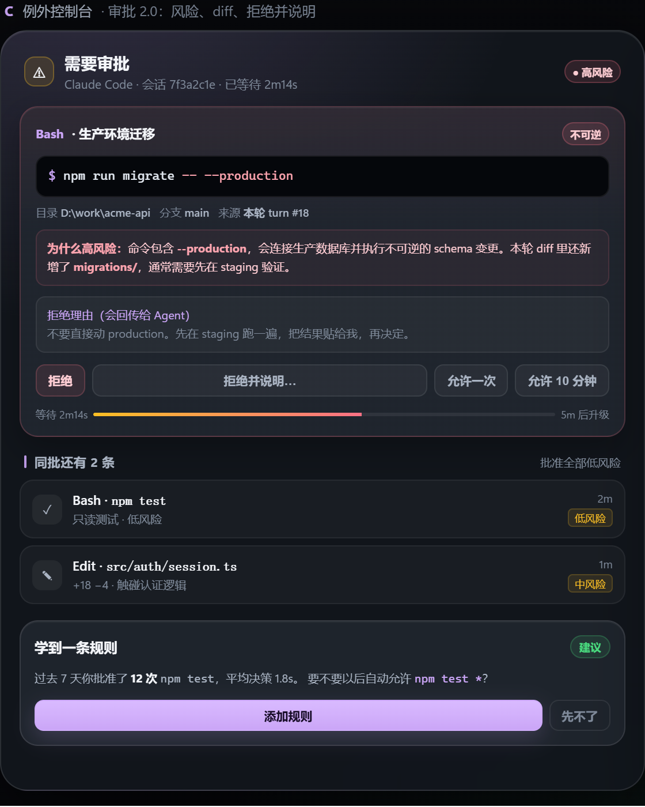
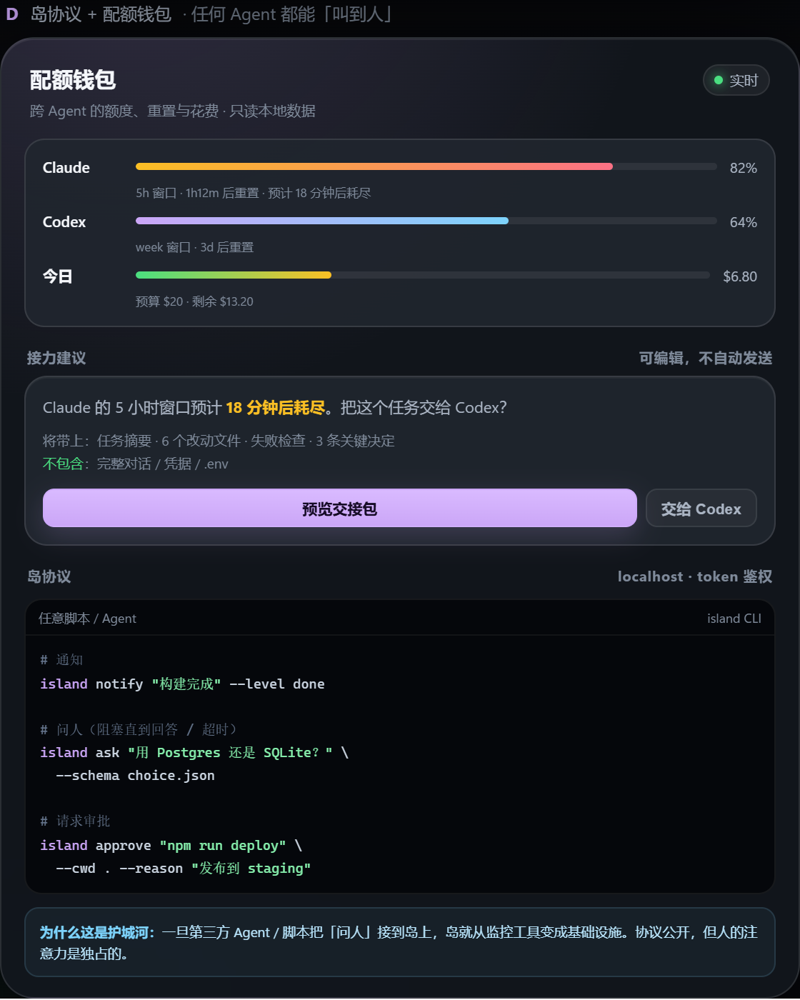

# 下一阶段功能提案：从「看见 Agent」到「验收 Agent」

> 调研时间：2026-10-28。对象：Agent Island v1.9.1 现状、2026 年 Agent 编排/监控/审批生态、Claude Code 与 Codex 的最新能力、MCP/ACP 协议进展。
>
> 结论先行：**不要再做「更多 Agent 管理」，要做「Agent 工作的验收与注意力层」。** 岛的形状正在商品化，真正升值的是三件事：**完成是否可信、异常是否被看见、任何 Agent 是否能接入这个「人」的入口**。

---

## 0. 一句话结论

把产品定位从

> 「一眼看到正在运行的 AI Agent，并在桌面上控制它们」

升级为

> **「你的 Agent 把活干完了——由岛来告诉你：它到底做了什么、是否真的通过、现在需不需要你。」**

这不是加一个面板，而是把「状态真相源」从**进程/回合状态**推进到**工作结果状态**：`done` 不再等于「Agent 说完成了」，而是「有回执、有检查、有证据的完成」。

---

## 概念稿（先看四张图）



- **A** 展开态：待你处理 + 本轮回执（岛内主视图）
- **B** 回执详情：一眼看懂「改了什么、是否真的通过」
- **C** 例外控制台：审批 2.0，风险、diff、拒绝并说明
- **D** 岛协议 + 配额钱包：任何 Agent 都能「叫到人」

> 这些是**概念稿**，不是已实现功能；用于讨论信息层级与交互，颜色/文案/布局实现时会按现有 token 与视觉回归调整。

---

## 1. 我们现在在哪

### 1.1 已经领先的部分

| 能力 | 现状 | 竞品普遍状态 |
| --- | --- | --- |
| Windows 常驻灵动岛 | 三态、托盘、全局快捷键、多显示器、开机自启 | Mac 优先，Windows 少 |
| 跨 Agent | Claude Code / Codex / OpenCode / Hermes，配置式适配器 | 多数只支持 1–2 个 |
| 状态真相源 | 结构化事件 + 会话绑定，文本不决定状态 | 多数靠日志关键词猜 |
| 审批 | Claude hooks 阻塞式 Allow/Deny、允许清单、审计 | 少数有，且多为简单卡片 |
| 控制闭环 | 发消息、停止、重启、恢复、打开目录、内置 ConPTY 终端 | 多数「只看不控」 |
| 用量 | Claude 5 小时窗口、Codex 额度、费用、每日预算 | 独立工具，未与 Agent 控制融合 |
| 工程可信度 | Rust/单元/浏览器/视觉回归、单实例、原子写、CSP | 多数早期项目没有 |

这些是护城河的地基，但**不是不可复制的**：EchoIsland 已经在 Windows 上做到 Terminal 标签页级跳转与「不抢焦点」的 passive 窗口刷新；Baton 已经用「任意 CLI + 工作区通知 + review」覆盖 Windows；Earr22/agent-island 直接以「Windows 灵动岛 + Codex 额度 + Claude 审批」为卖点。**「岛」本身正在变成红海。**

### 1.2 真正的短板

| 短板 | 用户当下的感受 | 后果 |
| --- | --- | --- |
| **完成不可验证** | 「它说做完了，我还得自己跑测试、看 diff」 | 岛只能告诉用户「Agent 说完成了」，不能替用户下判断 |
| **事件不可追溯** | 通知几秒就消失，昨天的失败今天找不到 | 无法复盘、无法交接、无法审计 |
| **审批缺上下文** | 只看到一条命令和 cwd，不知道会改什么、风险多大 | 审批疲劳，最后变成无脑点「允许」 |
| **离开后没有摘要** | 开会/吃饭回来，不知道刚才发生了什么 | 岛在「离开」这段时间价值归零 |
| **协议仍是私有适配器** | 每接一个新 Agent 都要写解析器 | 生态扩展慢，新 Agent 潮来了接不住 |
| **Windows 细节未拉满** | 跳回终端只到窗口，不到 Tab；自动展开的焦点行为缺少显式验证 | 与 EchoIsland 等相比，日常摩擦更明显 |

---

## 2. 市场在发生什么（2026）

### 2.1 编排层：并行已是免费商品，评审才是瓶颈

Tom Rochette 在 2026-09 的[编排工具矩阵](https://blog.tomrochette.com/agents/orchestration-feature-matrix/)里比较了 14 个工具（Claude Squad、cmux、Conductor、Crystal、dmux、Emdash、Gas Town、Happy Coder、JetBrains Air、Omnara、Paseo、Superset、Vibe Kanban、Worktrunk），给出的判断很直接：

> 「并行已经是这个品类里的免费商品：人们真正愿意付钱的只有**评审体验**和**远程执行**。」

同一篇里还有两句更重要的：

- 「**评审才是这个品类实际在卖的东西**（Review is the bottleneck this category actually sells）。」
- 14 个工具里，Crystal 已于 2026-02 停止、Vibe Kanban 已无人维护；「纯 worktree 会话管理器」很容易变成功能，而不是产品。

**含义**：我们如果现在去做「多 Agent 并行 + worktree + 看板」，是在进入一个拥挤、且被 Claude Code 自带 agent teams 向上挤压的赛道。**应该做它们都还没做好的「最后一公里」：Agent 说完成之后，人怎么快速相信并接手。**

### 2.2 信任层：96% 不完全信任，只有 48% 会验证

Sonar 的 [2026 State of Code 调研](https://www.sonarsource.com/company/press-releases/sonar-data-reveals-critical-verification-gap-in-ai-coding/)（1,100+ 专业开发者）给出的标题就是「Verification Gap」：

- **96%** 的开发者不完全信任 AI 输出；
- 只有 **48%** 会去验证；
- AI 已占 committed code 的约 **42%**。

Stack Overflow [2026 开发者调研](https://survey.stackoverflow.co/2026/)（30,903 份回答）进一步细化了「信任」：

- **66%** 使用 coding assistant / coding agent；
- **48%** 表示「只有当我能轻松验证输出时才信任」；
- 只有 **6.6%** 愿意在重要决策上信任；
- **78.7%** 认为来源/出处（source attribution）重要。

**含义**：用户不是不想信任 Agent，而是**缺少低成本的验证手段**。谁把「验证」做成一次点击、一眼能看懂的回执，谁就拿到了这个品类最贵的信任。

### 2.3 授权层：审批疲劳是结构性的，auto mode 也不是终点

Anthropic 在 [Claude Code auto mode 的工程博客](https://www.anthropic.com/research/claude-code-auto-mode)里承认了一个关键事实：

> 用户最终会接受 **93%** 的权限请求。长期下来就是 approval fatigue，人不再认真看自己批准了什么。

auto mode 用分类器替代人工审批，但博客自己给出了诚实的数字：

- 在 10,000 条真实工具调用上，误报率（FPR）从 8.5% 降到 **0.4%**；
- 但在 52 条真实的「过度主动」危险动作上，仍有 **17% 的漏报率（FNR）**；
- 连续 3 次拒绝或累计 20 次拒绝，才升级给人。

**含义**：auto mode 会减少「低风险常规操作」的打扰，但**高风险的例外更需要一个懂上下文的人类入口**。岛的机会不是「替用户点允许」，而是「只在真正需要人的时候，把上下文、风险、选项一次讲清楚」。

Codex 社区也在提同样的需求：[issue #11176「Add time/use-bounded approvals to reduce risk without prompt fatigue」](https://github.com/openai/codex/issues/11176)——不是要更少的安全，而是要**更有结构、更有范围、更少重复**的授权。

### 2.4 注意力层：谁解决「哪个 Agent 在等我」，谁就赢了并行

cmux 的[调研笔记](https://blog.tomrochette.com/agents/cmux/)给它的定义是：

> 「cmux 真正卖的是**注意力路由**（attention routing），不是多路复用。」

它的 notification rings、unread panel、跳到最近未读 Agent，是 27k stars 的核心。Baton 在[对比 Conductor](https://getbaton.dev/guides/conductor-vs-baton)时也把「workspace notifications and monitoring」列为核心差异：左侧栏一眼看到 running / waiting / finished / review-ready。

**含义**：岛天然就是注意力层，但现在的事件是**瞬时卡片**，不是**可追踪的待办**。把「通知」升级成「收件箱 + 离开摘要」，是低成本、高感知的一步。

### 2.5 协议层：MCP elicitation、ACP、hooks 都成熟了

- **MCP** 在 [2026-07-28 规范](https://modelcontextprotocol.io/specification/2026-07-28/client/elicitation)里把 **Elicitation** 做成了标准能力：Server 可以在任务中途向用户要结构化输入，支持 form / url 两种模式，返回 accept / decline / cancel。Claude Code 的 MCP 文档也明确写了「MCP servers can request structured input from you mid-task using elicitation」。
- **Claude Code hooks** 已经覆盖 `PreToolUse`、`PostToolUse`、`PermissionRequest`、`Notification`、`Stop`、`SubagentStop`、`SessionStart`、`SessionEnd`、`PreCompact`、`UserPromptSubmit`、`Elicitation` / `ElicitationResult` 等事件（见 [Hooks reference](https://code.claude.com/docs/en/hooks)）。其中 `PermissionRequest` 与 `PreToolUse` 一样带 `tool_name` / `tool_input`；`Elicitation` 可以把 MCP 的表单请求转给外部 UI。
- **ACP（Agent Client Protocol）** 已被大量 harness 采用（矩阵里 OpenCode、Cline、goose、OpenHands、Junie、Kilo Code、Qwen Code、Warp 等都支持 ACP）；Claude Code 也有 [`claude-code-acp`](https://pypi.org/project/claude-code-acp/) 适配器。

**含义**：岛的适配器不必永远自己解析日志。**先把「人能回答问题」这件事标准化（MCP/HTTP），再把「Agent 能接进来」标准化（hooks/ACP）**，是从 4 个 Agent 扩展到「任何 Agent」的捷径。

### 2.6 Windows 竞争在升温

| 产品 | 定位 | 对我们的威胁 |
| --- | --- | --- |
| [EchoIsland](https://github.com/FunplayAI/EchoIsland) | Windows 优先的 Dynamic Island，hook 审批、终端跳回 | 点击审批卡片时约 80% 能命中 Terminal **标签页级**跳转；用 `SWP_NOACTIVATE` 做 passive 刷新；MIT |
| [Earr22/agent-island](https://github.com/Earr22/agent-island) | 「Windows Dynamic Island for Codex status, quotas, and Claude Code approvals」 | 定位几乎重叠，说明「岛 + 额度 + 审批」已被复制 |
| [Baton](https://getbaton.dev/) | 跨平台、任意 CLI、workspace 通知/监控/review/sandbox | 功能更全，抢的是「工作区管理器」 |
| [Emdash](https://emdash.com/) | 跨平台、25+ CLI、worktree、SSH-first | 抢的是「并行 + 远程」 |

**含义**：Windows 不再是空白，而是**正在被填满**。我们的差异化不能是「我们也有岛」，只能是「**我们的岛更可信、更懂什么时候该叫人、更能接进任何 Agent**」。

---

## 3. 功能提案

下面按「对定位的贡献」排序。每项给出：用户价值、证据、体验、技术落点、边界、指标。

### P0-1 任务回执（Task Receipt）：把 `done` 变成「可验证的 done」

#### 一句话

Agent 每次结束一个回合，岛自动生成一张**本地回执**：改了什么文件、跑了什么检查、哪些检查过了、有没有风险动作、花了多少钱、有没有「说了但没做」的声明；用户可以一键「通过 / 让 Agent 修 / 回滚 / 导出」。

#### 为什么是现在

- 验证缺口是最大的、被数据反复证明的痛点（Sonar 96/48；SO 48%）。
- 编排工具把「评审」当作核心卖点，但它们的评审是**工作区级**的；岛可以做**回合级、跨 Agent、零切换**的「第一道验收」。
- Claude Code 已有 checkpointing/rewind，用户已经被教育「改坏了可以退」；岛可以把这种预期扩展到所有 Agent，并且给出「退之前先看清楚」的回执。
- 我们已经有 `turn` 状态机与 `Stop` 事件，缺的只是「结果侧」的证据采集。

#### 用户看到什么

**收起态**：状态点旁边多一个小徽标：

- `✓` 绿：本轮有回执，检查通过；
- `!` 黄：回执已生成，但没有配置检查 / 检查未跑完；
- `×` 红：检查失败，或发现高风险改动。

**展开态**：新增「本轮回执」卡片：

```
本轮回执                                    6 文件  +184 −32
✓ typecheck   2.1s
✓ test        42 passed  8.4s
! lint        1 warning
⚠ 删除了 1 个测试文件  ·  触碰 migrations/
💰 $0.42 · 18.2k tokens · 4m12s
[通过]  [让 Agent 修]  [查看 diff]  [回滚]
```

**总览窗口**：新增「回执」页签，左侧按时间列出回执，右侧是文件树 + unified diff + 检查输出 + 时间线（命令、审批、文件变更）。

**通知**：`Claude 完成了，但 test 失败 2 项`，直接带「让 Agent 修」按钮。



#### 回执里到底有什么

```ts
interface TaskReceipt {
  schema_version: 1;
  id: string;
  agent_id: string;
  session_id: string;
  turn_id: string;
  started_at_ms: number;
  ended_at_ms: number;
  repo: {
    root: string;
    branch: string | null;
    base_commit: string | null;   // 回合开始时的 HEAD
    base_tree: string | null;     // git stash create 产生的快照（含未提交改动）
    head_commit: string | null;
  };
  changes: {
    files: number;
    insertions: number;
    deletions: number;
    untracked: number;
    items: ReceiptFile[];         // path, status, +/-, binary?
  };
  checks: CheckResult[];          // name, command, status, exit_code, duration_ms, summary, output_excerpt
  approvals: ReceiptApproval[];   // tool, command, decision, rule?, at_ms
  usage: { tokens_total: number; cost_usd: number | null } | null;
  risks: RiskFlag[];              // code, severity, detail
  claims: ClaimCheck[];           // agent 说的 vs 证据
  verdict: "verified" | "partial" | "failed" | "unverified";
}
```

**风险标记（本地规则，不调用模型）**：

- `outside_repo`：写到了仓库外；
- `deletes_tests`：删除/清空测试文件；
- `touches_migrations`：`migrations/`、`schema.sql` 等；
- `touches_ci`：`.github/workflows`、`Jenkinsfile`；
- `touches_secrets`：`.env`、`*.pem`、`credentials`；
- `large_diff`：超过阈值（例如 800 行）；
- `lockfile`：`package-lock.json` / `Cargo.lock` 被改；
- `network` / `force_push` / `global_install`：从审批命令里识别；
- `binary`：二进制文件变更。

**声明核对（ClaimCheck）**：

从 Agent 最后的自然语言里提取「我跑了测试 / 全部通过 / 构建成功 / 改了 X」这类声明，与证据比对：

- 说「tests pass」，但本轮没有任何测试命令成功执行 → `未找到证据`；
- 说「改了 3 个文件」，实际 6 个 → `数量不一致`；
- 说「没有改配置」，但 `package.json` 变了 → `不一致`。

注意用词：**「未找到证据」而不是「它在撒谎」**。这是产品可信度的一部分。

#### 技术落点（贴着现有架构）

| 模块 | 作用 |
| --- | --- |
| `src-tauri/src/receipt.rs`（新） | 回执模型、汇总、持久化（`~/.agent-island/receipts/<session>/<turn>.json`，原子写、保留最近 N 条） |
| `src-tauri/src/git_probe.rs`（新） | 只读 git 命令：`rev-parse`、`status --porcelain=v2 -z`、`diff --numstat`、`diff --stat`、`stash create`、`diff <base>`；不引入 git2 依赖 |
| `src-tauri/src/checks.rs`（新） | 项目类型探测（package.json / Cargo.toml / pyproject / go.mod / Makefile）、命令白名单、超时、输出截断、并发限制 |
| `hooks.rs` | 扩展 hook 事件：`PostToolUse`（记录动作）、`PermissionRequest`（带 tool_input）、`SessionStart/End`、`SubagentStop`、`PreCompact` |
| `commands.rs` | `get_receipt` / `list_receipts` / `run_checks` / `apply_receipt_patch` / `export_receipt` |
| 前端 | `ReceiptCard.svelte`、`ReceiptDrawer.svelte`、`ReceiptsView.svelte`（总览） |
| 测试 | 临时 git 仓库 fixture：干净/脏工作区、未跟踪文件、二进制、删除测试、检查失败、超时；浏览器用 mock bridge 覆盖三种 verdict |

**关键技巧：用 `git stash create` 做回合基线。**

它不会改动工作区，只返回一个 commit 对象，能同时覆盖「回合开始前就有未提交改动」的情况。回合结束时 `git diff <base>` 就是**这一回合真正新增的改动**，而不是「当前工作区 vs HEAD」的模糊结果。这比很多工具的做法更准确，也容易写单测。

**检查的边界**：

- 首次检测到项目类型时**询问一次**「是否在每次完成后自动跑 `npm test` / `cargo test`？」，默认不自动跑重命令；
- 只跑用户确认过的命令，命令来自仓库配置或用户输入，**不接受 Agent 提供的任意命令**；
- 超时（默认 120s）、输出上限（8KB）、可取消；
- 没有配置检查时，verdict 明确写 `unverified`，UI 不显示绿色 ✓。

#### 回滚的边界

不要做「一键把工作区恢复到回合前」这种危险动作。第一版只做：

1. 生成 `turn.patch`（`git diff <base>`）；
2. 用户点「回滚」时先展示将被还原的文件；
3. 用 `git apply -R --check` 预检，冲突就中止并提示；
4. 只还原**本回合改动过的文件**，不碰用户在这期间的手动改动；检测到冲突时明确说「有冲突，未执行」。

Claude Code 自己的 checkpointing 可以作为「Agent 内建回滚」的补充，但跨 Agent、跨 CLI 的统一回执仍然由岛提供。

#### 指标

- 有回执的回合占比；
- 回执打开率；
- 「让 Agent 修」使用率 / 修复后通过率；
- 回滚成功率、冲突率；
- 用户自报「验收时间」下降（访谈/问卷）。

#### 反方观点

「跑测试很慢、很吵，用户可能不想每次自动跑。」——所以默认询问、按仓库记忆、只跑用户选中的检查；回执即使没有检查也有价值（diff + 风险 + 声明核对）。

**回执 2.0 的方向：context provenance + 行级评论。** Stack Overflow 2026 里 78.7% 的开发者认为「来源/出处」重要，但现在的回执只回答「改了什么」，还没回答「它凭什么这么改」。下一步可以把 Agent 读过的文件、网页、工具输出、检索结果做成一条「上下文来源」时间线（只记路径/标题/哈希，不存全文），让用户能追问「这个结论是从哪来的」。同时，回执详情里可以对 diff 行留言，留言作为一条 prompt 发回 Agent（review comment → agent），把「评审」和「修复」接成一个闭环。第一版先不做，避免范围膨胀；但 schema 里预留 `context_sources` 与 `review_comments` 字段。

---

### P0-2 注意力收件箱（Inbox）：从「弹卡」到「待办队列」

#### 一句话

把所有需要人的事件（审批、提问、报错、完成、预算、失控）变成**持久化、可分级、可批量处理**的收件箱；收起态显示「几件事在等你」，离开回来给一张「离开摘要」。

#### 为什么是现在

- cmux 的 notification rings / unread panel 是它 27k stars 的核心；Baton 也把 workspace notifications 当卖点。
- 我们现在的通知卡是瞬时的，`notifications` 只存在内存里；用户一走开就丢。
- 审批已经有「待确认」信号，但没有「队列」语义：不能 snooze、不能批量、不能看历史、不能区分「必须现在」和「可以等」。

#### 用户看到什么

**收起态**：

- 岛右上角一个小数字徽标：`3`；
- 颜色取最高优先级：审批=黄、错误=红、完成=绿；
- 悬停 tooltip：「2 个审批 · 1 个报错」。

**展开态**：顶部新增「待你处理」区（可折叠）：

```
待你处理  3                           [全部] [只看高风险]
⚠ Claude · 需要审批  rm -rf build/         高风险  12s
? Codex  · 在问你    用 Postgres 还是 SQLite？   1m
! Claude · 完成了    6 文件 · test 失败 2 项      3m
```

键盘：`J/K` 移动，`Enter` 打开，`A/D` 允许/拒绝，`S` snooze，`E` 标记已读。

**离开摘要**：当窗口失焦超过 N 分钟（默认 10）后首次展开，显示一张摘要卡：

```
你离开的 47 分钟
✓ 2 个任务完成（1 个通过检查，1 个 test 失败）
⚠ 3 个审批在等你（最早 12 分钟前）
💰 本轮花费 $1.24 · 今日 $6.80 / $20
[逐条处理]  [全部标为已读]
```

**总览窗口**：新增「收件箱」页签，支持按 Agent / 类型 / 时间过滤；已解决条目保留 7 天。



#### 数据模型

```ts
interface InboxItem {
  id: string;
  kind: "approval" | "question" | "error" | "done" | "budget" | "watchdog" | "digest";
  severity: "low" | "normal" | "high" | "critical";
  agent_id: string | null;
  session_id: string | null;
  title: string;
  body: string;
  actions: InboxAction[];       // allow/deny/open/retry/snooze...
  state: "open" | "seen" | "snoozed" | "resolved" | "expired";
  created_at_ms: number;
  snooze_until_ms: number | null;
  resolved_at_ms: number | null;
  dedupe_key: string;           // 同 agent+session+kind+摘要 去重
}
```

存储：`~/.agent-island/inbox.json`，原子写，最多 300 条；审批类与审计日志分开（审计不可删）。

#### 技术落点

- Rust `inbox_store.rs`：增删改查、去重、过期、持久化；
- `AppState` 增加 `inbox`，启动时载入；
- 事件源：hooks（Stop / Notification / PermissionRequest / SubagentStop / SessionEnd）、状态机（error）、预算（daily budget）、回执（checks failed）、失控守卫；
- 前端 `InboxPanel.svelte`、`DigestCard.svelte`；`App.svelte` 的 `notifications` 改为从 inbox 投影；
- 通知预算：每小时最多 N 次系统级打扰，其余静默进收件箱；
- 专注模式：只有 `approval` / `critical` 打断，其余排队。

#### 指标

- 平均响应时间（从 item 创建到 resolve）；
- 错过的审批数（过期/自动回退）；
- 每小时打扰次数；
- 摘要卡打开率 / 逐条处理率；
- 「snooze 后是否还记得」——snooze 到期提醒的点击率。

#### 反方观点

「收件箱会不会让岛变重？」——收起态仍然只有一个小徽标；展开态才出现列表。它替代的是现在散落的通知卡，不是额外增加一层。

---

### P0-3 审批 2.0（Exception Console）：只在例外时叫人，但一次讲清楚

#### 一句话

把「一条命令 + 允许/拒绝」升级为**带上下文、风险、范围、理由**的例外控制台：能看 diff、能拒绝并说明、能限时/限范围授权、能批量处理低风险项、能从历史中学习规则。

#### 为什么是现在

- auto mode 会过滤掉大量低风险操作，但在真实「过度主动」样本上仍有 17% 的漏报；这些漏报正是最需要人看的。
- 用户接受 93% 的请求，说明「更多提示」没有意义；**提示的质量**才是问题。
- 我们目前的审批只覆盖 `PreToolUse` 的 Bash；文件编辑不弹卡，用户看不到「它到底要改什么」。
- `PermissionRequest` hook 带 `tool_input`，足以对 Edit/Write 渲染 diff 预览；这是现在就能做的。

#### 用户看到什么

```
需要审批 · Claude Code · 会话 7f3a              ⚠ 高风险
Bash  npm run migrate -- --production
D:\work\api  ·  main  ·  由本轮 turn 触发
风险：会改动生产数据库；命令包含 --production
[拒绝]  [拒绝并说明…]  [允许一次]  [允许 10 分钟]  [允许这类命令]
```

对编辑类：

```
需要审批 · Claude Code · Edit
src/auth/session.ts                      +18 −4
- if (token.expired) return null;
+ if (token.expired) { await refresh(); return getToken(); }
风险：触碰认证逻辑；该文件有 3 个未覆盖测试
[查看完整 diff]  [拒绝]  [允许]
```



#### 关键交互

1. **拒绝并说明**：弹一个输入框，用户写「不要用 production，先在 staging 验证」；理由回传给 Agent，让它按理由重试（而不是简单失败）。这是「deny-and-continue」的人机版。
2. **限时授权**：允许 10 分钟 / 本回合 / 本会话；到期自动失效。对应 Codex #11176 的诉求。
3. **范围授权**：允许这条命令、允许这个前缀模式、允许这个工具在这个仓库；规则预览明确写出「以后自动允许：`npm test *`」。
4. **批量**：多个待审批按风险分组；「批准全部低风险」需要二次确认，高风险永远逐条。
5. **学习**：同一命令被批准 3 次后，卡片底部出现「要不要以后自动允许 `npm test *`？」；一键添加并写审计。
6. **审计**：每次决定记录 `tool / command / cwd / risk / decision / rule / reason / at`；可在总览筛选、导出 JSONL。

#### 技术落点

| 模块 | 作用 |
| --- | --- |
| `hooks.rs` | 同时接 `PreToolUse`（策略/允许清单）与 `PermissionRequest`（UI 卡片）；扩展 bridge 脚本，把 `tool_input`（截断）带到 Rust |
| `approval_rules.rs` | 风险分级、范围匹配、限时 grant、规则建议；现有 `classify_command` 扩展为 `risk_of(tool, input, cwd)` |
| `diff_preview.rs`（新） | 对 Edit/Write 的 `old_string/new_string/content` 生成轻量 diff；对 Bash 不做假 diff |
| `commands.rs` | `respond_approval(id, decision, scope, reason)`；`list_pending_approvals`；`approval_audit` |
| 前端 | `ApprovalCard.svelte` 重做：风险 chip、diff 预览、范围选择、理由输入、批量头 |
| 测试 | 风险规则表驱动；限时 grant 过期；拒绝理由回传；Edit diff 渲染；批量只影响低风险 |

#### 安全边界

- 风险分级**只依据本地规则**，不调用模型，避免「模型说服模型」；
- `tool_input` 里的内容可能包含敏感信息（文件内容、token），显示前走隐私遮罩；
- 自动允许规则必须由用户显式创建，默认关闭；创建时展示完整 scope；
- 「允许 10 分钟」只对同一会话、同一工具、同一模式生效，且进程退出即失效；
- 拒绝理由会进入 Agent 上下文，提示用户不要在里面写密钥。

#### 指标

- 审批平均决策时间；
- 盲批率（<2 秒内点允许的比例，越低越好）；
- 自动允许规则命中率 / 撤销率；
- 高风险审批占比；
- 拒绝后 Agent 成功改道的比例。

---

### P1-4 失控守卫（Runaway Guard）：在烧钱之前叫停

#### 一句话

用结构化事件 + 本地启发式，识别「原地打转 / 反复报错 / 长时间无进展 / 花费异常」，先在岛上给证据，再让用户选择「继续 / 换个思路 / 停止」。

#### 为什么是现在

- Agent 的失败模式里，「卡住但仍在烧 token」是用户最焦虑、也最容易被忽视的；社区已有 `stallguard`、`loopguardian`、`pi-anti-doom-loop` 这类工具出现。
- Anthropic 的 auto mode 博客记录了真实的「过度主动」事故（删远程分支、上传 token、对生产库跑迁移），说明「无人看守的自主」需要护栏。
- 我们已有每日预算、进程状态、日志、turn 状态，缺的是「异常模式」的识别与呈现。

#### 信号（第一版，全部可解释）

- 同一工具 + 同一输入（归一化后）连续出现 ≥3 次；
- 同一错误签名（去掉数字/路径）连续出现 ≥2 次；
- 连续 N 次工具调用后 `git status` 无变化（Agent 在「读」但没有「写」）；
- 单回合时长超过该 Agent 的 p95（本地历史）；
- 每分钟 token/费用超过阈值；
- 额度剩余 <10% 或预计 30 分钟内耗尽。

#### 用户看到什么

```
⚠ 可能卡住了 · Claude Code
过去 8 分钟：`npm test` 执行了 6 次，错误相同（TS2345）
本轮已花费 $2.10（平时 $0.35）
[继续观察]  [让它换个思路…]  [停止]
```

「让它换个思路」会发送一条用户可编辑的提示，而不是自动 kill。默认**不自动停止**；只有用户开启「预算硬停」时才在阈值处停止。

#### 技术落点

- `watch.rs`（新）：事件窗口、签名归一化、规则评估；
- 数据源：`PostToolUse` hook（工具/输入哈希/结果摘要）、日志尾部、usage 增量、进程 CPU；
- UI：`HealthBadge` + `WatchdogCard`；收件箱 `watchdog` 类型；
- 配置：阈值可调；按 Agent / 仓库覆盖；「静音此类提醒」。

#### 风险

- 假阳性：长测试、合法重试、网络抖动都可能触发；所以只做**建议**，文案用「可能」；
- 隐私：错误签名要脱敏，不能把文件内容写进通知；
- 性能：事件窗口只在有活跃 Agent 时计算，空闲不跑。

---

### P1-5 跨 Agent 接力 + 配额钱包（Handoff & Quota Wallet）

#### 一句话

把「Claude 额度快用完了」变成「把任务交接给 Codex，并带上足够的上下文」；把「我该用哪个 Agent」变成一张看得懂的配额/成本/能力卡。

#### 为什么是现在

- Stack Overflow 2026：Anthropic 与 OpenAI 的使用率几乎持平（75% vs 74%），大量开发者同时持有两边订阅。
- 用量监控工具（Claude-Code-Usage-Monitor、ccusage、ClaudeBar 等）合计上万星，说明「额度」是日常焦虑。
- 编排矩阵里，「远程执行」是少数真正愿意付费的能力；跨 Agent 接力的价值类似：**不让工作因为某个额度墙停下来**。
- 我们已经有 Claude 5 小时窗口、Codex 额度、费用、重置时间——这是很多工具没有的「跨 Agent 视角」。

#### 用户看到什么

**配额钱包**（展开态一行 / 总览卡）：

```
Claude  5h  82%  ·  1h12m 后重置
Codex   week 64%  ·  3d 后重置
今日 $6.80 / $20
```

**接力卡**（额度 >90% 或失败时出现）：

```
Claude 的 5 小时窗口快用完了（92%，预计 18 分钟后耗尽）
把这个任务交给 Codex？
将带上：任务摘要 · 6 个改动文件 · 失败测试 · 3 条关键决定
[预览交接包]  [交给 Codex]  [先不了]
```

交接包是**用户可编辑**的 Markdown，默认不包含完整对话/密钥；发送前展示全文。

#### 技术落点

- `usage.rs` 扩展：统一 `QuotaWallet`，跨 Agent 的余额/重置/预测；
- `handoff.rs`（新）：从会话日志、回执、git diff 生成交接包模板；
- 启动：复用现有 `run_task`（Codex `exec --json`）或打开终端；新会话自动绑定；
- 预测：基于最近 30 分钟 burn rate 线性外推，标注「粗略估计」；
- 配置：是否允许自动建议、是否包含 diff、是否包含用户提示词。

#### 边界

- **默认不自动切换**：跨模型可能改变质量、成本、隐私边界；只建议，用户确认。
- 不把代码发给用户没有明确选择的 provider；发送前展示目标与内容。
- 交接包不包含凭据、`.env`、完整路径；隐私遮罩开启时进一步脱敏。

---

### P1-6 岛协议（Island Protocol）：让任何 Agent 都能「叫到人」

#### 一句话

把岛从「4 个 Agent 的适配器集合」变成「人的标准入口」：先提供本地 HTTP/CLI（`island notify/ask/approve`），再包一层 MCP server，最后接 Claude Code 的 `Elicitation` hook 与 ACP。

#### 为什么是现在

- MCP elicitation 已是标准；Claude Code 已支持 MCP server 在任务中向用户要结构化输入，也暴露了 `Elicitation` hook。
- ACP 被大量 harness 采用，`claude-code-acp` 已存在；继续为每个 Agent 写日志解析器，边际成本只会越来越高。
- 我们已经有 `127.0.0.1:8799` 的本地事件服务器、token 鉴权、hook bridge；把它扩展成公开 API 是最小改动。

#### 分三步走

**Step 1：HTTP + CLI（1–2 周，低风险）**

```
POST /v1/notify   { title, body, level, agent?, session? }
POST /v1/ask      { question, schema?, timeout_ms }   → 阻塞直到用户回答
POST /v1/approve  { command, cwd, reason? }           → allow/deny
POST /v1/report   { progress, message }
```

- 只绑定 `127.0.0.1`；token 复用 hooks 的鉴权；Origin 检查；速率限制；
- 附带 `island.cmd` / `island.exe` 包装，CI、脚本、任意语言都能调用；
- `ask` 的返回支持 `accept / decline / cancel`，与 MCP 语义一致。

**Step 2：MCP server（2–3 周）**

- 提供 `ask_human`、`notify`、`approve`、`report_progress` 四个工具；
- 在设置里一键写入 Claude Code / Codex / Cline 的 MCP 配置（带备份）；
- `ask_human` 支持 form schema（string/number/boolean/enum/multi-select），在岛上渲染成表单；
- 超时/离线时明确返回 `decline`，不让 Agent 卡死。

**Step 3：Elicitation + ACP（探索）**

- 接 Claude Code 的 `Elicitation` / `ElicitationResult` hook：MCP server 的 form 请求直接弹在岛上，而不是终端里；
- ACP 客户端实验：用 `claude-code-acp` 或其它 ACP adapter 起会话，处理 `session/request_permission`、`session/update`、diff；
- 这一步不做承诺，先用一个 Agent 做端到端验证；验证不通过就停在 Step 2。



#### 为什么这是护城河

- 一旦第三方 Agent/框架通过 `island ask` 把「问人」接到岛上，岛就从「监控工具」变成了**基础设施**；
- 我们可以保持「本地优先、无云账号」的差异，和云端 control plane（Omnara 等）区分开；
- 协议是公开的，但**人的注意力**是独占的——用户不会同时看两个岛。

#### 安全边界

- 所有写操作（approve/ask）都要 token；
- `approve` 默认只返回「待人工确认」，不允许 Agent 直接自我批准；
- 表单渲染禁止 HTML/脚本，只接受纯文本与受限 schema；
- 审计所有 API 调用（谁、何时、什么内容哈希）。

---

### P2-7 战绩榜 / 周报（Outcome Flywheel）

#### 一句话

用回执数据回答「哪个 Agent 在我的仓库里真的更好用」：首次验证通过率、返工率、每个被接受改动的成本、平均审批次数；每周给一张可分享的报告。

#### 为什么值得做

- 现在所有「模型排行榜」都是通用的；**没有一个是「在你的仓库、你的任务类型上」的**。岛有本地数据，这是独占的。
- 回执提供了以前没有的「结果标签」（verified / failed / rework），才能算「每个被接受改动的成本」。
- **对比模式（A/B）**：同一任务让两个 Agent 各跑一遍（各自 worktree），回执并排比较 checks、diff、cost、time；适合高风险改动或选型。成本翻倍，默认手动触发。
- 周报是低成本的增长素材（用户愿意分享「我本周让 Agent 干了什么」）。

#### 指标

- 首次验证通过率（first-pass verified rate）；
- 返工率（同一任务 24h 内再次修改）；
- `cost per accepted change`；
- 平均审批次数 / 审批耗时；
- 按任务类型（重构/修 bug/新功能/测试）拆分，样本量不足时显示「数据不足」。

#### 边界

- 小样本不排名，只显示区间/置信度；
- 不把「行数」当生产力；
- 不默认上传任何数据；分享卡只包含聚合数字。

---

### P2-8 Windows 原生细节 + 英文 UI

#### Windows 细节（竞争平权，不是差异化）

- **Terminal 标签页级跳转**：EchoIsland 已用 UI Automation 的 `runtime_id` + 缓存/学习做到约 80% 命中；我们目前只到窗口级。建议按「显式绑定 → 自动学习 → token 兜底」三层做，误绑时明确说「已跳到窗口，未定位到 Tab」。
- **自动展开不抢焦点**：所有非用户触发的窗口操作走 `SWP_NOACTIVATE`，避免 `ShowWindow` 的隐式激活；把「passive / interactive」做成命名约定与测试。
- **全屏/共享时自动隐藏**：检测前台全屏窗口与常见会议/录屏进程；至少做到「全屏时收起为热区」。注意 Tauri 透明窗口在真全屏之上有平台限制，别承诺做不到的事。
- **Windows 专注助手同步**：读取系统勿扰状态，岛内专注模式跟随；不写系统设置。
- **多显示器跟随**：岛跟随当前活动窗口所在显示器，而不是固定主屏。

#### 英文 UI（增长杠杆）

- 目前界面几乎全中文，README 有英文但产品没有；这会把大量潜在用户挡在门外。
- 建议先做「中文 + 英文」两套字典（不引入重型 i18n 框架），把所有用户可见文案集中到 `src/i18n/`；英文版先覆盖设置、审批、回执、收件箱、错误文案。
- 同步更新视觉基线（英文更长，容易溢出）；用伪本地化（pseudo-locale）先测布局。

---

### 快速赢（1–3 天/项，可与上面并行）

| 点子 | 说明 |
| --- | --- |
| 审批卡显示「这条命令会做什么」 | 用本地规则生成一句人话，例如「删除 build 目录，不影响源码」 |
| 审批卡显示仓库/分支 | 现在只有 cwd；补 `git rev-parse --show-toplevel` 与分支 |
| 审批 SLA | 卡片上显示「已等待 2m」，超过 5 分钟升为黄色 |
| 完成通知带「查看回执」 | 即使回执功能没做完，也先给「打开总览」深链 |
| 托盘「暂停所有 Agent」 | 只对岛内启动的 PTY 生效，外部进程明确标注「无法暂停」 |
| 通知深链 | `agent-island://session/<id>`，点击直达对应会话 |
| 会话备注/标签 | 给长任务起名，交接和搜索都受益 |
| 周报卡片 | 先用现有 stats 生成「本周用时/花费/完成数」，不依赖回执 |
| 一键复制回执 Markdown | 粘到 PR / Slack / issue |
| 预算预警分档 | 50/80/100%，不同颜色与文案；100% 时询问「硬停？」 |

---

## 4. 优先级与路线图

### 4.1 评分

评分口径：Impact（对定位/留存）、Effort（1 小 – 5 大）、Risk（1 低 – 5 高）、Moat（可防御性）、Evidence（A 一手数据 / B 二手 / C 推断）。

| 功能 | Impact | Effort | Risk | Moat | Evidence | 结论 |
| --- | --- | --- | --- | --- | --- | --- |
| 任务回执 | 5 | 4 | 3 | 5 | A | **v2.0 · headline** |
| 注意力收件箱 | 5 | 2 | 2 | 3 | A | **v1.10 先做** |
| 审批 2.0 | 4 | 3 | 3 | 4 | A | **v1.10 同批** |
| 失控守卫 | 4 | 3 | 3 | 3 | B | v2.1 |
| 接力 + 配额钱包 | 4 | 3 | 4 | 4 | B | v2.1 |
| 岛协议（HTTP/MCP） | 4 | 4 | 3 | 5 | A | v2.1–v2.2 |
| 战绩榜/周报 | 3 | 3 | 2 | 4 | C | v2.2 |
| Windows 细节 | 3 | 3 | 2 | 2 | A | 持续 |
| 英文 UI | 4 | 3 | 2 | 2 | B | v2.2 或单独 |

### 4.2 路线图

#### v1.10「收件箱与例外」（约 3–4 周）

- 持久化收件箱 + 收起态徽标 + 离开摘要；
- 审批 2.0：风险 chip、diff 预览（Edit/Write）、拒绝并说明、限时/范围授权、批量低风险；
- 扩展 hooks：`PostToolUse`、`PermissionRequest`、`SessionStart/End`、`SubagentStop`（先把事件采到，回执后用）；
- 快速赢：审批卡显示仓库/分支/SLA、通知深链、托盘暂停。

**验收**：连续 3 天真实使用，所有审批/完成/报错都能在收件箱里找到；离开 10 分钟后回来能看到摘要；审批卡对 Edit 能显示 diff；无焦点抢占回归。

#### v2.0「任务回执」（约 6–8 周）

- 回执采集（git base + diff + checks + approvals + usage + risks + claims）；
- 收起态 ✓/!/× 徽标、展开态回执卡、总览回执页；
- 「让 Agent 修」把失败检查 + diff 摘要发回会话；
- 回滚补丁（预检 + 冲突中止）；
- 检查配置向导（按仓库、询问一次、可关闭）。

**验收**：在 3 个真实仓库（Node/Rust/Python 各一）上，回合结束后 5 秒内出回执；检查失败能一键发回并看到 Agent 修复；回滚在冲突时明确中止；所有 verdict 有测试覆盖。

#### v2.1「守住与接力」（约 4–6 周）

- 失控守卫（建议式，不自动 kill）；
- 配额钱包 + 接力包；
- 岛 API（HTTP + CLI）+ MCP server 的最小版本（`ask_human` / `notify`）。

**验收**：一个第三方脚本能通过 CLI 让岛弹通知并拿到用户回答；Codex 额度 >90% 时能生成可编辑交接包并启动新任务；失控提醒有证据、可关闭。

#### v2.2「协议与数据」（按验证结果）

- Claude Code Elicitation hook 表单 UI；
- ACP 客户端实验（只承诺一个 Agent）；
- 战绩榜 / 周报；
- 英文 UI。

> 注：这里的 v2.0 会取代 `ROADMAP.md` 里 2026-08 的 v2.0「智能化」占位（用量预测已部分落地；会话快照/空闲清理可并入 v2.1，不单独占一个版本）。如果接受这份提案，需要同步更新 ROADMAP 与验证记录。

---

## 5. 明确不建议做

| 不做 | 原因 |
| --- | --- |
| 多 Agent 并行 + worktree 看板 | 14 个竞品已在做；Claude Code 自带 agent teams；我们的岛不适合承载工作区管理 |
| 云执行 / 自建 relay / 手机 App | Happy Coder、Omnara、cmux Cloud 已占位；安全与运维成本高；先做「通知出站」而非「远程控制」 |
| 插件市场 UI | v1.1 已砍；`agents.json` + MCP/ACP 才是扩展方向 |
| 通用聊天 / IDE | harness 厂商自己会做；岛应保持「薄」 |
| 模型代理 / 自动路由花钱 | 成本、合规、质量风险；只做建议，不替用户下单 |
| 更多主题/动画 | 边际收益递减；当前视觉已足够，信任层才是短板 |

### 5.1 整体风险与反方

| 风险 | 为什么真实 | 应对 |
| --- | --- | --- |
| **Harness 厂商自己把回执/验证做了** | Claude Code 已有 checkpointing、auto mode、agent teams、routines；Codex 也在加 skills/cloud | 我们做**跨 Agent、本地、面向人**的那一层，不与单家厂商的闭环竞争；它们越强，越需要一个中立的地方看「所有 Agent 的完成质量」 |
| **「验证」做不准，反而制造假信任** | 检查没配置、测试很弱、Agent 改测试来通过，都会让绿色 ✓ 变得危险 | 没有证据就不给绿；verdict 分级；显示检查命令与覆盖范围；「通过」是人的动作，不是系统的自动判定；用测试钉住「无证据不得 verified」 |
| **功能变重，岛不再「轻」** | 收件箱、回执、审批 2.0 都会增加信息密度 | 收起态仍然只有一个数字徽标；展开态分层（待你处理 → 回执 → 卡片）；所有新面板可折叠；性能预算进 CI |
| **Windows 细节被竞品拉开** | EchoIsland 已做 Tab 级跳转与 passive 刷新，Baton 跨平台 | 把「Tab 级跳转 / 不抢焦点 / 全屏隐藏」列为 v1.10 的竞争平权项，不当作可选项 |
| **协议做了没人接** | MCP/ACP 生态还在快速变化 | 先做 HTTP/CLI（任何语言都能接），再包 MCP；用 Claude Code 的 Elicitation hook 做第一个真实场景；不承诺 ACP 时间表 |

---

## 6. 定位与商业（简短）

### 6.1 一句话定位

> **The human endpoint for agents.**  
> 不是又一个 Agent 管理器，而是 Agent 干完活之后，人做判断的那一层。

### 6.2 谁可能付费

- **个人 Pro**：自定义检查、回执导出、周报、更多 Agent；
- **团队**：共享收件箱、策略包（按仓库/风险）、审计导出、SSO；
- **不付费墙**：基础审批、安全、隐私、本地数据。

市场参照：Conductor 约 $50/月、cmux Pro $40/月、Superset $15–20/用户/月；团队愿意为「评审/远程/审计」付费，个人愿意为「省时间」付费。**验收与审计是最接近付费意愿的**。

### 6.3 分发

- 英文 UI + winget/Scoop + 一张 30 秒 GIF：Agent 说完成 → 岛弹回执 → test 失败 → 一键发回 → 通过；
- README 首屏从「功能列表」改成「一个真实场景」；
- 不投广告，先在 Claude Code / Codex / Windows 开发者社区做 dogfood 分享。

---

## 7. 两周验证计划（在写代码之前）

1. **访谈 5 个用户**（至少 3 个同时用 Claude Code + Codex）：
   - 最近一次「Agent 说完成但其实没完成」是什么情况？你怎么发现的？花了多久？
   - 你离开电脑 30 分钟回来，第一件事是看什么？
   - 你上一次点「允许」时，真的看了命令吗？为什么？
   - 如果岛给你一张回执，你最想看到哪三样？
   - 你愿意为「自动跑测试 + 回执」付钱吗？多少？
2. **可点击原型**：回执卡 + 收件箱 + 离开摘要（用假数据），让 3 个人完成「验收一个失败任务」的任务，记录卡点。
3. **最小 MVP**：只做 Codex `exec --json` + git diff + 一个检查命令（`npm test` 或 `cargo test`），在真实仓库跑 10 个任务。
4. **Go / No-Go**：
   - Go：≥60% 的任务愿意配置检查；≥50% 的回执被打开；≥30% 的失败回执使用「让 Agent 修」；
   - No-Go：用户觉得「还不如自己看终端」；或检查运行时间/噪音不可接受——那就退回「只做 diff + 风险 + 声明核对」的轻回执。

---

## 8. 参考资料

- Tom Rochette, [Orchestration Feature Matrix](https://blog.tomrochette.com/agents/orchestration-feature-matrix/)（2026-09 更新）
- Tom Rochette, [cmux](https://blog.tomrochette.com/agents/cmux/)、[Emdash](https://blog.tomrochette.com/agents/emdash/)
- Sonar, [Verification Gap 新闻稿](https://www.sonarsource.com/company/press-releases/sonar-data-reveals-critical-verification-gap-in-ai-coding/)、[State of Code 报告](https://www.sonarsource.com/blog/state-of-code-developer-survey-report-the-current-reality-of-ai-coding/)
- Stack Overflow, [2026 Developer Survey](https://survey.stackoverflow.co/2026/)、[新闻稿](https://stackoverflow.co/company/press/archive/stack-overflow-annual-developer-survey-ai-trust-conditional)
- Anthropic, [How we built Claude Code auto mode](https://www.anthropic.com/research/claude-code-auto-mode)
- Claude Code Docs: [Hooks reference](https://code.claude.com/docs/en/hooks)、[Permission modes](https://code.claude.com/docs/en/permission-modes)、[Checkpointing](https://code.claude.com/docs/en/checkpointing)、[Agent teams](https://code.claude.com/docs/en/agent-teams)、[Routines](https://code.claude.com/docs/en/routines)、[Desktop scheduled tasks](https://code.claude.com/docs/en/desktop-scheduled-tasks)
- Codex, [issue #11176: time/use-bounded approvals](https://github.com/openai/codex/issues/11176)
- MCP, [Elicitation (2026-07-28)](https://modelcontextprotocol.io/specification/2026-07-28/client/elicitation)
- [claude-code-acp](https://pypi.org/project/claude-code-acp/)
- EchoIsland Windows 细节：[Terminal 标签页跳转 + window surface](https://gitcode.csdn.net/6a02a36b54b52172bc736b55.html)
- Baton, [Conductor vs Baton](https://getbaton.dev/guides/conductor-vs-baton)
- Earr22, [agent-island](https://github.com/Earr22/agent-island)
- Happy Coder, [How it works](https://happy.engineering/docs/how-it-works/)
- Paseo, [Orchestration](https://paseo.sh/docs/orchestration)

---

## 附录 A：与现有代码的落点对照

| 新能力 | 现有可复用 | 需要新增 |
| --- | --- | --- |
| 回执 | `domain/status.rs`、`session_scan.rs`、`hooks.rs`、`usage.rs` | `receipt.rs`、`git_probe.rs`、`checks.rs`、回执 UI |
| 收件箱 | `App.svelte` 的 notifications/approvals、`stats_store.rs` 的原子写模式 | `inbox_store.rs`、InboxPanel、DigestCard |
| 审批 2.0 | `approval_rules.rs`、`hooks.rs`、`ApprovalStack.svelte` | `diff_preview.rs`、风险分级、范围/限时 grant |
| 失控守卫 | `agent_tasks.rs` 事件、`usage.rs`、进程扫描 | `watch.rs`、健康徽标 |
| 接力 | `usage.rs`、`run_task`、会话日志 | `handoff.rs`、QuotaWallet |
| 协议 | `hooks.rs` 的 8799 服务、token 鉴权 | HTTP API、MCP server、CLI |
| 战绩 | `stats_store.rs`、回执 | 聚合查询、周报渲染 |

## 附录 B：一句话电梯稿

> Agent 们越来越会干活，但人越来越不知道它们干得对不对。Agent Island 下一步不做「更多 Agent」，而是做 **Agent 的回执、收件箱和例外审批**：每一次「完成」都有证据，每一件「需要你」都不会丢，每一个 Agent 都能通过一个本地协议叫到你。**岛是形状，信任才是产品。**
